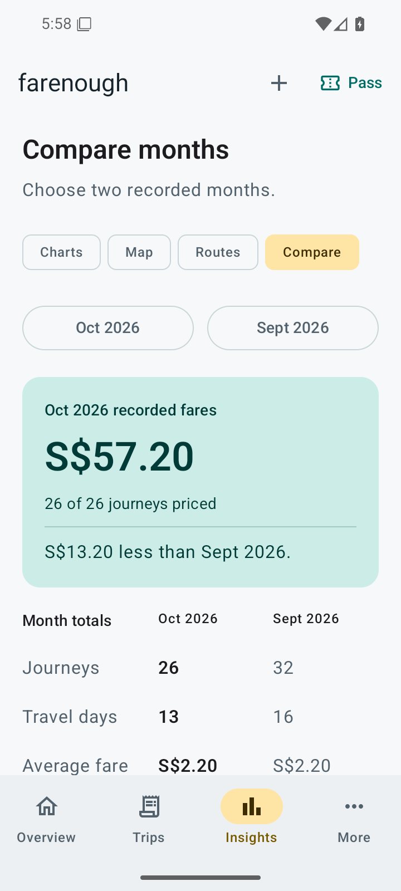

<div align="center">

<a href="https://holsoma.github.io/farenough/">
  
</a>

# farenough

### Has your train pass paid for itself?

Record your Singapore MRT and LRT journeys. Compare their fares with your concession pass.

[](https://github.com/holsoma/farenough/releases)
[](https://github.com/holsoma/farenough/actions/workflows/checks.yml)
[](https://holsoma.github.io/farenough/docs/getting-started/)
[](LICENSE)

## Download

[](https://holsoma.github.io/farenough/download/)
[](https://github.com/holsoma/farenough/releases/latest)

**Android 8.0+ · Free and open source · No account or tracking**

[Website](https://holsoma.github.io/farenough/) · [Documentation](https://holsoma.github.io/farenough/docs/) · [Changelog](https://holsoma.github.io/farenough/changelog/) · [Report an issue](https://github.com/holsoma/farenough/issues)

</div>

## Watch the app

https://github.com/user-attachments/assets/07c87fc1-00d1-4c29-a1ae-998c11a61a4f

Trip tracking, pass comparison and monthly travel graphs. The video uses demonstration records and example fares.

## A look inside

<p align="center">
  <a href="site/public/screenshots/overview.png"></a>
  <a href="site/public/screenshots/month-comparison.png"></a>
  <a href="site/public/screenshots/map.png"></a>
</p>

<p align="center"><sub>Actual app screens with invented records and example fares.</sub></p>

## Features

Compare recorded months by fares, journeys, travel days and average fare. Explore a month directly from its history bar, with labelled station connections and interactive daily charts.

| | What you can do |
| --- | --- |
| **Pass comparison** | Compare recorded adult fares with the price and dates of your undergraduate train pass. |
| **Automatic fares** | Choose stations to see the adult fare and rail fare distance, offline. Save favourite routes and correct individual fares. |
| **Trip targets** | See how many more journeys would cover your pass, using an average fare or a selected route. |
| **Charts and maps** | Explore daily totals, rail fare distance, your most travelled routes and monthly connections across Singapore. |
| **Import your old notes** | Copy a formatting prompt into an AI chat tool, then review and import its normalised JSON. |
| **Your data, on your device** | Use the app offline. Export full backups or CSV files, and restore your records when needed. |

> [!NOTE]
> **Fare coverage:** v0.3.0 adds derived historical adult fares for 16,106 station pairs from 1 March 2025 through 11 July 2026, using the tariff for each date and excluding routes that may have changed with CCL6. Full coverage remains 12 July through 25 December 2026 for all 16,836 pairs among 184 MRT/LRT stations. Saved fares and corrections take precedence. Uncertain routes and unsupported dates remain unpriced. Automatic transfers, time discounts and bus fares are outside scope. See [data sources and coverage](DATA_SOURCES.md#selective-historical-fares-in-030).

## Documentation

| Guide | Start here to… |
| --- | --- |
| [Getting started](https://holsoma.github.io/farenough/docs/getting-started/) | Install the app and set up your pass. |
| [Recording journeys](https://holsoma.github.io/farenough/docs/recording-trips/) | Add trips, favourite routes and fare corrections. |
| [Importing your records](https://holsoma.github.io/farenough/docs/importing/) | Bring in notes you have kept elsewhere. |
| [Understanding the fares](https://holsoma.github.io/farenough/docs/fare-calculations/) | See what counts towards the comparison. |
| [Targets, charts and maps](https://holsoma.github.io/farenough/docs/targets-and-insights/) | Read the trip targets and explore your travel history. |
| [Backups and updates](https://holsoma.github.io/farenough/docs/backups-and-updates/) | Keep your records when updating or changing devices. |

## Install and update

Download the signed APK attached to a GitHub release and open it on your phone. Android may ask you to allow installation from that browser or file manager. To update, install the new APK over the old app. **Do not uninstall first:** uninstalling removes local records. Direct APK installs do not update automatically.

Each release includes a SHA-256 checksum and signing-certificate details. See [SIGNING.md](SIGNING.md) to verify the app's identity, or [RELEASING.md](RELEASING.md) for the release process. Debug builds use a separate application ID.

## Build

Install JDK 21, Android SDK API 36 and Build Tools 36.0.0. Configure `JAVA_HOME` and `ANDROID_HOME` or the SDK location in Android Studio.

Use Python 3 to restore the ignored fare asset from the published APK. The helper verifies the APK and asset against the checksums in [data/rail-fares-source.json](data/rail-fares-source.json). This is a build step; the installed app remains offline.

```sh
python scripts/restore_rail_fares.py
./gradlew :core:test :app:assembleDebug :app:lintDebug
./gradlew :app:connectedDebugAndroidTest
```

On Windows use `gradlew.bat`. The optional `scripts/local-env.ps1` uses project-local tools if they exist, without changing system settings.

```sh
cd site
npm ci
npm run build
npm run dev
```

The website requires Node.js 24, or at least 22.23.4, and serves at `/farenough/`.

## Data and privacy

The app has no internet permission. Data lives in its private Room database. Android cloud backup and automatic device transfer are excluded; use explicit backup/restore. Exported files are unencrypted and go to the location you choose. The external LLM workflow only shares text when you paste it into that external service.

Map sources, transformations and checksums are listed in [data/sources.json](data/sources.json) and [DATA_SOURCES.md](DATA_SOURCES.md). The fare table is distributed inside the APK, with no separate JSON download or copy in Git. The map shows endpoints, not actual rail paths. No geographic distances are used to calculate fares.

## Contribute

Read [CONTRIBUTING.md](CONTRIBUTING.md). Use synthetic examples in public issues, rather than private travel records. Implementation details and verified checks are recorded in [IMPLEMENTATION.md](IMPLEMENTATION.md). The [UI audit](UI_AUDIT.md) records the review findings and remaining limitations. Release screenshots are captured from the signed APK by the [screenshot workflow](.github/workflows/screenshots.yml), using invented records on an isolated Android emulator.

Code: [Apache 2.0](LICENSE). Data and font licences are documented separately in [NOTICE.md](NOTICE.md). This project is not affiliated with LTA, SimplyGo or any transport operator.
