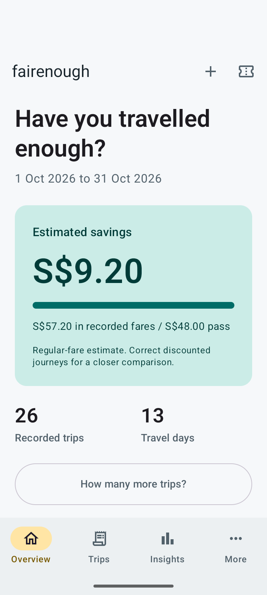
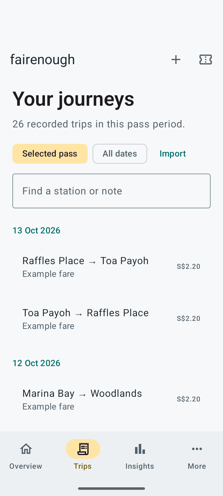
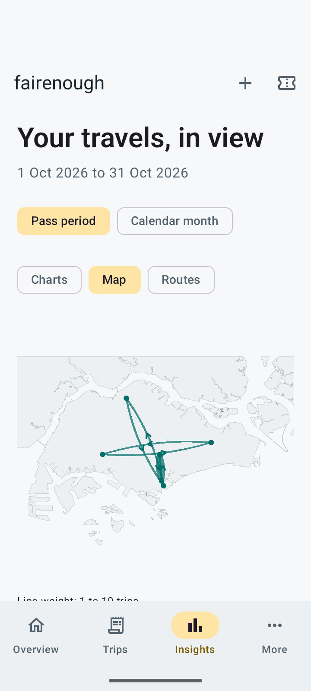

# fairenough

**Have your journeys covered the cost of your concession pass?**

fairenough is an open source Android app for tracking Singapore MRT and LRT journeys against an undergraduate train pass. It works locally, without an account, analytics or location permission.

[Download an APK](https://github.com/holsoma/fairenough/releases) · [User guide](https://holsoma.github.io/fairenough/docs/) · [Report an issue](https://github.com/holsoma/fairenough/issues)

Requires **Android 8.0 or later**. The first release is being prepared. Development status and verified checks are recorded in [IMPLEMENTATION.md](IMPLEMENTATION.md).

## What it does

- Records journeys, pass periods, favourite routes and individual fare corrections.
- Compares regular adult fares with the actual pass price.
- Imports normalised JSON using a formatting prompt you can give to any LLM.
- Shows average-fare and selected-route trip targets.
- Provides interactive charts, directional route rankings and an offline Singapore connection map.
- Exports complete backups and CSV files. Restore validates the file and requires a backup of existing records before replacement.

**Fare coverage:** this version uses saved, LTA-checked route fares, with explicit valid dates. It does not bundle a complete automatic fare matrix. Missing fares are never counted as zero. Automatic transfers, time discounts and bus fares are outside the first release.

## Screenshots

Screenshots are captured from the Android app using invented demonstration records and example fares. The capture procedure is in [the Android UI test](app/src/androidTest/java/io/github/holsoma/fairenough/AppJourneyTest.kt).

<p>
  
  
  
</p>

## Install and update

Download the signed APK attached to a GitHub release and open it on your phone. Android may ask you to allow installation from that browser or file manager. To update, install the new APK over the old app. **Do not uninstall first:** uninstalling removes local records. Direct APK installs do not update automatically.

Each release includes a SHA-256 checksum. See [RELEASING.md](RELEASING.md) for signing and verification. Debug builds use a separate application ID.

## Build

Install JDK 21, Android SDK API 36 and Build Tools 36.0.0. Configure `JAVA_HOME` and `ANDROID_HOME` or the SDK location in Android Studio.

```sh
./gradlew :core:test :app:assembleDebug :app:lintDebug
./gradlew :app:connectedDebugAndroidTest
```

On Windows use `gradlew.bat`. The optional `scripts/local-env.ps1` uses project-local tools if they exist, without changing system settings.

```sh
cd site
npm ci
npm run build
npm run dev
```

The website requires Node.js 24, or at least 22.23.4, and serves at `/fairenough/`.

## Data and privacy

The app has no internet permission. Data lives in its private Room database. Android cloud backup and automatic device transfer are excluded; use explicit backup/restore. Exported files are unencrypted and go to the location you choose. The external LLM workflow only shares text when you paste it into that external service.

Map sources, transformations and checksums are listed in [data/sources.json](data/sources.json) and [DATA_SOURCES.md](DATA_SOURCES.md). The map shows endpoints, not actual rail paths. No geographic distances are used to calculate fares.

## Contribute

Read [CONTRIBUTING.md](CONTRIBUTING.md). Use synthetic examples in public issues, rather than private travel records.

Code: [Apache 2.0](LICENSE). Data and font licences are documented separately in [NOTICE.md](NOTICE.md). This project is not affiliated with LTA, SimplyGo or any transport operator.
